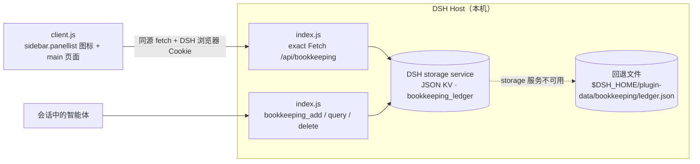

# dsh-bookkeeping · DSH 记账本

[dsh-bookkeeping](https://github.com/yyyzxj/dsh-bookkeeping) 是一个开源、无依赖的 **DeepSeek Harness (DSH)** Web 插件（bundle），为 DSH Web 增加一个全局的「记账本 / Ledger」面板：记录收入与支出、按月汇总、分类统计、搜索筛选，并允许智能体在对话中直接记账和查询。

插件完全在本机运行：账本数据由 DSH host 保存在你自己的 DSH 数据目录中，不上传云端、不采集遥测、不访问第三方服务。

> 语言：中文（本页） / [English](#english)

---

## 简介

DSH Web 的侧栏会多出一个「记账本」图标，点击后打开一个完整的主面板页面。页面包含：

- 一笔收支的录入表单（收入/支出、金额、分类、日期、备注）；
- 当前范围（按月或全部时间）的支出 / 收入 / 结余汇总卡；
- 「分类占比」分类明细条与按日期分组的账目列表；
- 类型、分类、关键字筛选以及 JSON 导入 / 导出。

同一份账本还通过 **智能体工具**（`bookkeeping_add` / `bookkeeping_query` / `bookkeeping_delete`）暴露给 DSH 智能体，因此你可以直接说「记一笔午饭 25 元」，或问「这个月花了多少钱？」。

## 功能特性

- **侧栏全局入口**：注册 `sidebar.panellist` 图标（id `bookkeeping`，label：记账本 / Ledger），点击后在主面板打开 keyed `main` 页面。
- **收支记录**：类型（支出 / 收入）、金额（正数，元）、13 个预设分类、日期（默认今天）、备注（可选）；编辑、删除（删除前确认）。
- **月度汇总**：支出 / 收入 / 结余三张汇总卡；`‹` `›` 切换月份，可在「全部时间」与按月范围之间切换。
- **分类分析**：按分类聚合的金额与笔数，「分类占比」条形明细，按金额降序。
- **搜索与筛选**：类型筛选、分类筛选、按备注 / 分类关键字搜索；列表按日期分组并显示每日合计。
- **JSON 导入 / 导出**：导出为 `dsh-bookkeeping-YYYY-MM-DD.json`，格式为 `{ plugin, version, exportedAt, entries }`；导入接受该导出文件或记录数组，按记录 id 合并。
- **智能体工具**：host 端注册 `bookkeeping_add`、`bookkeeping_query`、`bookkeeping_delete`，与页面共用同一个账本模型和同一份数据。
- **中英文界面**：通过 DSH 的 locale 服务注册中文 / 英文字符串，跟随 DSH 界面语言。
- **主题适配**：仅使用 `--dsw-alias-*` 主题变量，浅色 / 深色主题下保持一致；纯 JS、无构建步骤。
- **错误兜底**：host API 不可达时页面顶部显示错误横幅并提供「重试」，不会白屏；页面渲染异常由错误边界兜底。

## 安装

### 前置条件

- 已安装 **DSH 桌面版或带 Web GUI 的 DSH**（`dsh web`），并且该 DSH profile 支持安装本地目录 bundle；
- DSH 的插件页面（Plugins / 插件）支持「从本地目录添加 / Add from local directory」bundle，或可让智能体调用 `plugin_manager` 的 `install_bundle` 工具。

### 方式一：通过 DSH Web 插件界面（本地目录）

1. 把本仓库克隆或复制到本机任意目录：

   ```bash
   git clone https://github.com/yyyzxj/dsh-bookkeeping.git
   ```

2. 打开 DSH Web → **Plugins / 插件** 页面 → 选择「从本地目录添加 bundle」（Add from local directory，不同 DSH 版本的 UI 文案可能略有差异）→ 选择仓库根目录（即包含 `package.json` 与 `cordis.patch.yml` 的目录）→ 安装并启用 → 刷新页面。

3. 刷新后侧栏出现「记账本 / Ledger」图标，即可开始使用。

> 插件本身是纯 JavaScript、无运行时依赖，**克隆后不需要 `pnpm install` / `npm install`，也没有构建步骤**。

### 方式二：通过 `plugin_manager` 工具（智能体）

在 DSH 会话中让智能体安装该目录，等价于调用 `plugin_manager` 的 `install_bundle`：

- `target`（安装来源）：仓库在**本机的绝对路径**（Windows 例如 `D:\插件` 或 `D:\path\to\dsh-bookkeeping`；macOS / Linux 例如 `/path/to/dsh-bookkeeping`），也可以使用 `link:<目录>` 形式；
- 安装后确认 bundle 行 id 为 `bookkeeping`（entry 形如 `include:bookkeeping`）、application 为 `applied`，侧栏图标出现。如果安装后行未出现在 composition 中，可在 `plugin_manager` 中用 `set_bundle` 把 `dsh-bookkeeping` 设为启用，或检查 profile 的 bundle 选择列表。

本插件已通过上述方式在 DSH 桌面版 profile 中实际安装验证。

### 安装后的验证

- DSH Plugins 页面中能看到 id 为 `bookkeeping` 的 bundle 行，且状态为已启用 / applied；
- 侧栏出现「记账本 / Ledger」图标，打开后能正常加载账本页面；
- 会话中智能体可以调用 `bookkeeping_query` 等工具（例如提问「看看我的账本」）。

### 分发与 npm

`package.json` 声明了：

- `dsh.bundle.patch: "./cordis.patch.yml"` —— 这是 DSH bundle 的 Cordis patch，向 profile 插入 id 为 `bookkeeping` 的插件行；
- `dsh.client: { "platform": "web", "immediately": true }` —— 声明浏览器端半区。

因此该包既可作为本地目录 bundle 安装，也可以在发布到 npm 后作为普通 bundle 安装（这是后续的可选分发方式，当前仓库以本地安装为主）。

## 使用

1. **打开账本**：点击左侧栏的「记账本」图标，打开完整的 Ledger 页面。
2. **记一笔**：在左侧「记一笔」表单中选择支出的 / 收入、输入金额（大于 0，单位为人民币元）、分类、日期（默认今天）和备注，点击「记一笔」。保存成功后列表立即更新。
3. **查看汇总**：页面顶部三张卡显示当前范围的 **支出 / 收入 / 结余**；默认当前月份。
4. **切换时间范围**：使用月份旁的 `‹` `›` 按钮切换上 / 下个月，或在「全部时间」与按月之间切换；汇总、分类占比、列表会跟随范围变化。
5. **筛选与搜索**：在账本工具栏选择类型（全部 / 支出 / 收入）、分类，或在搜索框中输入备注 / 分类关键字。
6. **编辑 / 删除**：每条记录右侧有「编辑」「删除」按钮；编辑会把记录载入左侧表单，保存后生效；删除会先要求确认。列表按日期分组，并显示每日合计。
7. **导入 / 导出**：右上角「导出」下载当前全部记录的 JSON 文件；「导入」选择导出的 JSON 文件或记录数组，按记录 id 合并到本机账本（同 id 记录会被更新，其余新增）。
8. **隐私说明**：页面底部的状态栏会提示「数据由本机 DSH 服务保存，不会上传云端」。
9. **在对话中记账**：直接对智能体说「记一笔午饭 25 元，算餐饮」「上周打车花了 36」「这个月一共花了多少？」等，智能体会调用下方的工具完成操作。

## 数据存储

账本由 **host 端**（`index.js` + `ledger.js`）统一持有并持久化，客户端只通过受认证的 host API 读写。

- **主存储**：DSH 的存储服务（`ctx.get('storage')` 的 `json` KV 后端），单元名为 **`bookkeeping_ledger`**（version 1，表 `entries`，`layout: per-record`）。每条记录是独立的一份 JSON 文档，落盘路径形如：

  ```text
  <DSH_HOME>/storages/bookkeeping_ledger/entries/<id>.json
  ```

  Windows 默认 `DSH_HOME` 为 `C:\Users\<you>\.dsh`，例如：
  `C:\Users\<you>\.dsh\storages\bookkeeping_ledger\entries\<id>.json`（可用 `DSH_HOME` 环境变量覆盖）。

- **回退存储**：如果当前 profile 没有可用的 storage 服务，自动回退到普通 JSON 文件：

  ```text
  <DSH_HOME>/plugin-data/bookkeeping/ledger.json
  ```

  该文件采用原子写入（先写临时文件再重命名，目录 / 文件权限 700 / 600）。

- **无云同步、无遥测**：插件不发起外部网络请求，不收集任何使用数据；数据边界就是你的 `DSH_HOME`（不同 `DSH_HOME` 之间数据互不可见）。

一条记录包含以下字段：

| 字段 | 说明 |
| --- | --- |
| `id` | 记录 id（UUID；导入时可保留合法 id：字母 / 数字 / `_` / `-`，≤ 64 字符） |
| `type` | `expense`（支出）或 `income`（收入） |
| `amount` | 正数金额（元），四舍五入到分 |
| `category` | 分类 id（见下方分类表；导入的自定义短标签也会被保留） |
| `date` | `YYYY-MM-DD` 日期，默认今天（按本机日历日，不用 UTC） |
| `note` | 备注，≤ 200 字符 |
| `createdAt` / `updatedAt` | ISO 时间戳 |

校验限制：金额必须大于 0 且不超过 100,000,000；备注 ≤ 200 字符；分类标签 ≤ 40 字符；单次导入最多 10,000 条；记录按日期倒序、同日按创建时间倒序排列。

## 智能体工具

host 端通过 DSH 的 tools 服务注册以下工具（与页面共用同一套账本逻辑与同一份数据）：

### `bookkeeping_add`

记录一笔收入或支出。

| 参数 | 类型 | 必填 | 说明 |
| --- | --- | --- | --- |
| `type` | `string` | 是 | `expense`（花钱）或 `income`（收钱） |
| `amount` | `number` | 是 | 正数金额（元），例如 `25.5`；退款请用方向表示，不要传负数 |
| `category` | `string` | 否 | 分类 id，默认 `other`（见分类表） |
| `date` | `string` | 否 | `YYYY-MM-DD`，默认今天 |
| `note` | `string` | 否 | 简短备注，例如「午饭」「地铁」 |

返回中文文本，形如 `已记账：2026-11-08 支出 ¥25.00（餐饮，午饭）（id: …）`。

### `bookkeeping_query`

读取账本：列出记录或返回合计与分类明细。

| 参数 | 类型 | 必填 | 说明 |
| --- | --- | --- | --- |
| `action` | `string` | 否 | `list`（默认，列出记录，含 id）或 `summary`（收入/支出/结余合计 + 分类明细） |
| `month` | `string` | 否 | `YYYY-MM` 月份筛选；省略表示全部记录 |
| `type` | `string` | 否 | 方向筛选：`expense` 或 `income` |
| `category` | `string` | 否 | 分类 id 筛选 |
| `limit` | `integer` | 否 | 最多列出条数，1–200，默认 50 |

### `bookkeeping_delete`

按 id 删除一条记录（仅在用户明确要求删除时调用）。

| 参数 | 类型 | 必填 | 说明 |
| --- | --- | --- | --- |
| `id` | `string` | 是 | 记录 id，可从 `bookkeeping_query` 的 `list` 结果获得 |

### 分类 id

| id | 中文 | English | 方向 |
| --- | --- | --- | --- |
| `food` | 餐饮 | Food | 支出 |
| `transport` | 交通 | Transport | 支出 |
| `shopping` | 购物 | Shopping | 支出 |
| `housing` | 居住 | Housing | 支出 |
| `entertainment` | 娱乐 | Entertainment | 支出 |
| `medical` | 医疗 | Health | 支出 |
| `education` | 教育 | Education | 支出 |
| `salary` | 工资 | Salary | 收入 |
| `bonus` | 奖金 | Bonus | 收入 |
| `investment` | 理财 | Investment | 收入 |
| `parttime` | 兼职 | Side job | 收入 |
| `gift` | 红包 | Gift | 收入 / 支出 |
| `other` | 其他 | Other | 通用 |

未指定分类时默认为 `other`；界面按方向提供预设分类，host 端也接受导入数据中的自定义短标签。

## 架构

插件由 **host 半区**和 **client 半区**组成，两者通过 DSH 的受认证 exact Fetch 路由通信：



**Host 半区**（`index.js`、`ledger.js`）：

- `index.js` 导出 `apply(ctx)`：创建账本实例；通过 `ctx.get('storage')` 打开 `bookkeeping_ledger` KV 单元（不可用时回退 JSON 文件）；通过 `ctx.connection.fetch.register` 注册 exact Fetch 路由（`ROUTE_PATH = /api/bookkeeping`，与浏览器请求的完整路径一致，DSH connection 的 `/api` 前缀是路由键的一部分），支持 GET / HEAD / POST；通过 tools 服务注册三个智能体工具；所有变更共用同一 `Ledger` 队列串行执行并持久化。
- `ledger.js`：记录模型、校验、金额/日期规范化、汇总与分类聚合、JSON 文件存储适配器（原子写）、KV 单元存储适配器。

**Client 半区**（`client.js`）：

- 以 `window.__ModuleLoader__.load({ id: 'dsh-bookkeeping', factory(require) })` 注册惰性模块，从模块表 `require('react')`，使用 `React.createElement` 渲染，**无构建步骤**；
- `apply(ctx)` 中通过 `ctx.slots.inject` / `ctx.slots.register` 注册：
  - `sidebar.panellist`：id `bookkeeping`、order 20、label（记账本 / Ledger）；
  - `main`：key `bookkeeping` 的完整页面；
- 中 / 英文字符串通过 DSH locale 服务注册，页面样式仅使用 `--dsw-alias-*` 主题变量。

**Bundle 声明**：`cordis.patch.yml` 向 profile 插入 id 为 `bookkeeping`、name 为 `dsh-bookkeeping` 的插件行；`locale/zh.json` 与 `locale/en.json` 提供插件元数据（标题与描述）。

## 权限与隐私

- DSH Web 服务默认只监听**回环地址（127.0.0.1 / localhost）**；
- 插件的 host 路由是 DSH 的 exact Fetch 路由，请求由 **DSH 自带的浏览器 Cookie / 会话认证**保护，并且只接受同源请求；插件不新增端口、不引入额外的鉴权体系；
- 账目数据只保存在本机 `DSH_HOME` 下（见「数据存储」），不上传、不联网、不采集遥测；
- 智能体工具与页面操作走同一 host API，权限边界与 DSH 会话一致；
- 注意：**能访问你本机 DSH Web 界面的人即可查看和修改账本**。请不要把 DSH 服务暴露到公网，并妥善保管 `DSH_HOME` 目录（系统盘备份 / 云同步工具可能会复制账本数据）。

## 环境要求

- **DSH**（桌面版或 `dsh web`），需要 **Web GUI** 与 profile bundle 安装能力；
- 插件运行在 DSH host 内，**不需要额外安装 Node.js 运行时**、不需要构建工具；
- 若 host 半区未加载、或页面在非 Web 运行时中打开而无法访问 host API，Ledger 页面会显示错误横幅并提供「重试」，而不会崩溃；
- 本仓库已随附本地自检脚本 `node test/check.mjs`（需要 Node.js 20+，无第三方依赖），CI 使用 Node 20。

## 开发与测试

```bash
git clone https://github.com/yyyzxj/dsh-bookkeeping.git
cd dsh-bookkeeping
node test/check.mjs
```

- 目录结构：

  ```text
  index.js            host 半区入口：storage、/api/bookkeeping 路由、智能体工具
  ledger.js           账本模型、校验、汇总、存储适配器
  client.js           client 半区：window.__ModuleLoader__ 工厂、侧栏图标与主页面
  cordis.patch.yml    DSH bundle patch（插入 id: bookkeeping 的插件行）
  locale/zh.json      中文插件元数据
  locale/en.json      英文插件元数据
  icon.svg            侧栏 / 页面图标
  test/check.mjs      无依赖自检（17 项：manifest、locale、图标、patch、语法、模型与持久化）
  ```

- 本地开发方式：把仓库目录作为 link bundle 安装到当前 profile，修改文件后**刷新 DSH Web 页面**即可生效（无 watch、无构建）；如需重新加载 host 半区，按 DSH 的插件启用 / 重载流程操作。
- 提交前请运行 `node test/check.mjs`，并确保 `node --check index.js`、`node --check client.js` 通过。
- CI：GitHub Actions（`.github/workflows/ci.yml`）在 push / PR 到 `main` 时用 Node 20 执行 `node --check index.js`、`node --check client.js`、`node test/check.mjs`。

## 已知限制

- **单用户、本机账本**：没有多用户 / 多端同步 / 权限体系；
- **仅人民币（元）**：金额单位固定为 CNY，无多币种与汇率；
- 暂不支持**预算**、**周期性 / 自动记账**、**自定义分类管理**（当前为 13 个预设分类 id，但导入数据中的自定义短标签会被保留）；
- 数据以 **`DSH_HOME` 为界**：不同 DSH home / 不同机器之间数据互不相通；
- 导入按记录 id 合并，没有「覆盖全部」或撤销操作；单次导入上限 10,000 条；
- 本仓库的离线自检不渲染 UI；开发过程中页面已通过离线 React Test Renderer 渲染验证与 DSH slot 实际挂载验证，**暂无浏览器截图或视觉回归测试**；
- host 不可达时页面只读地显示错误横幅（工具调用同样依赖 host 正常运行）。

## 许可证

本项目使用 **MIT License**，详见 [LICENSE](./LICENSE)。

Copyright (c) 2026 yyyzxj

欢迎通过 GitHub Issues 提交问题与建议。

---

<a id="english"></a>

# dsh-bookkeeping · English

An open-source, dependency-free **DeepSeek Harness (DSH)** Web plugin (bundle) that adds a global **Ledger** panel: record income and expenses, view monthly totals and category breakdowns, search and filter entries, import/export JSON, and let the agent record or query entries directly from chat.

Everything runs locally: the ledger is stored by the DSH host in your own DSH data directory. No cloud sync, no telemetry, no third-party requests.

## Features

- **Sidebar entry point**: registers a `sidebar.panellist` icon (id `bookkeeping`, label “Ledger”) that opens a full keyed `main` panel page.
- **Entries**: expense/income, positive CNY amount, one of 13 preset categories, date (defaults to today), optional note; edit and delete (with confirmation).
- **Monthly summaries**: expense / income / balance cards; `‹` `›` month navigation and an “All time” range.
- **Category breakdown**: per-category amounts and counts, sorted by amount.
- **Search & filters**: type filter, category filter, keyword search over notes/categories; the list is grouped by day with per-day totals.
- **JSON import/export**: export downloads `dsh-bookkeeping-YYYY-MM-DD.json` as `{ plugin, version, exportedAt, entries }`; import accepts that file or a bare array of entries and merges by entry id.
- **Agent tools**: `bookkeeping_add`, `bookkeeping_query`, `bookkeeping_delete` registered on the host, sharing the same ledger model and data as the UI.
- **Bilingual UI**: zh/en strings registered through DSH’s locale service.
- **Theme aware**: only `--dsw-alias-*` theme tokens; plain JS with no build step.
- **Graceful failures**: an error banner with a retry button if the host API is unavailable, plus a render error boundary.

## Install

Prerequisites: DSH (desktop app or `dsh web`) with the Web GUI, and a profile that supports installing a bundle **from a local directory** (“Add from local directory” in the Plugins page, or the `plugin_manager` / `install_bundle` tool). Exact UI wording may differ between DSH versions.

1. Clone the repository anywhere on the machine:

   ```bash
   git clone https://github.com/yyyzxj/dsh-bookkeeping.git
   ```

2. In DSH Web, open the **Plugins** page → “Add bundle from local directory” → select the repository root (the folder containing `package.json` and `cordis.patch.yml`) → install/enable it → refresh the page.
3. The sidebar now shows the **Ledger** icon and the Ledger page opens.

Alternatively, ask the agent to call `plugin_manager` → `install_bundle` with `source` set to the repository’s absolute path (e.g. `D:\path\to\dsh-bookkeeping` on Windows or `/path/to/dsh-bookkeeping` on macOS/Linux); `link:<dir>` also works. Verify the bundle row id is `bookkeeping`, the application is `applied`, and that the sidebar icon appears.

The plugin itself is plain JavaScript with **no runtime dependencies, no build step**: no `pnpm install` / `npm install` is needed. Because `package.json` declares `dsh.bundle.patch` (`./cordis.patch.yml`) and `dsh.client.platform: "web"`, it can also be published to npm later as a regular bundle; this repo currently targets local installation.

## Usage

1. Click the **Ledger** icon in the sidebar.
2. Fill the “Add an entry” form (expense/income, amount > 0 in CNY, category, date, optional note) and submit.
3. The top cards show **Expenses / Income / Balance** for the current range (current month by default).
4. Use `‹` `›` to change months, or switch to **All time**.
5. Filter by type/category or search notes/categories; entries are grouped by day.
6. Edit loads the entry into the form; delete asks for confirmation.
7. **Export** downloads all entries as JSON; **Import** accepts an exported file or an array of entries and merges by id.
8. From chat, simply ask the agent: “record lunch for 25 CNY under food”, “how much did I spend this month?”, “delete that entry”.

## Data storage

The host half owns the records; the client half only talks to the authenticated host API.

- Primary store: DSH’s storage service — a `json` KV unit named **`bookkeeping_ledger`** (version 1, table `entries`, `layout: per-record`), persisted as one JSON document per entry:

  ```text
  <DSH_HOME>/storages/bookkeeping_ledger/entries/<id>.json
  ```

  (`DSH_HOME` defaults to `~/.dsh`, e.g. `C:\Users\<you>\.dsh` on Windows; overridable via the `DSH_HOME` environment variable.)

- Fallback when the storage service is unavailable: a plain JSON file at `<DSH_HOME>/plugin-data/bookkeeping/ledger.json`, written atomically.

- Each entry has `id`, `type` (`expense`/`income`), `amount` (positive CNY, rounded to cents), `category`, `date` (`YYYY-MM-DD`, local calendar day), `note` (≤ 200 chars), `createdAt` and `updatedAt`. Limits: amount > 0 and ≤ 100,000,000; category ≤ 40 chars; up to 10,000 entries per import. Records are sorted by date descending, then creation time descending.

- No cloud sync, no telemetry: data never leaves the machine and is scoped to your `DSH_HOME`.

## Agent tools

| Tool | Parameters | Purpose |
| --- | --- | --- |
| `bookkeeping_add` | `type` (required, `expense`/`income`), `amount` (required, positive number in CNY), `category`, `date` (`YYYY-MM-DD`), `note` | Record one income or expense entry. Returns Chinese confirmation text with the new id. |
| `bookkeeping_query` | `action` (`list` default or `summary`), `month` (`YYYY-MM`), `type` (`expense`/`income`), `category`, `limit` (1–200, default 50) | List matching entries with ids, or return income/expense/balance totals plus a category breakdown. |
| `bookkeeping_delete` | `id` (required) | Delete one entry by id (from a `bookkeeping_query` list). |

Preset category ids: `food`, `transport`, `shopping`, `housing`, `entertainment`, `medical`, `education`, `salary`, `bonus`, `investment`, `parttime`, `gift`, `other`. Unknown short labels from imported data are preserved.

## Architecture

- **Host half** (`index.js`, `ledger.js`): `apply(ctx)` builds the ledger over DSH’s storage service, registers the authenticated exact Fetch route `GET/POST /api/bookkeeping` through `ctx.connection.fetch.register` (`ROUTE_PATH = '/api/bookkeeping'`, the full pathname the shared `/api` handler matches), and registers the three agent tools through the tools service. `ledger.js` holds the model, validation, summaries, and the KV/file persistence adapters. Mutations are serialized through one `Ledger` queue.
- **Client half** (`client.js`): a lazy `window.__ModuleLoader__.load({ id: 'dsh-bookkeeping', factory(require) })` module that renders with `React.createElement` from the module table’s React — no build step. It registers the `sidebar.panellist` icon (id `bookkeeping`, order 20) and the keyed `main` page `bookkeeping`, uses DSH’s locale service for zh/en strings, and styles with `--dsw-alias-*` theme tokens only.
- **Bundle declaration**: `cordis.patch.yml` inserts the plugin row `id: bookkeeping`, `name: 'dsh-bookkeeping'`; `locale/*.json` provide display metadata.

## Privacy & security

- The DSH Web server binds to the loopback interface by default.
- The plugin’s host route is an exact Fetch route protected by DSH’s own browser cookie/session authentication and accepts same-origin requests only; the plugin opens no new ports and adds no separate auth system.
- Ledger data stays local under `DSH_HOME`; the plugin makes no external requests and collects no telemetry.
- Anyone who can access your local DSH Web UI can read and modify the ledger. Do not expose DSH to the public internet and treat the `DSH_HOME` directory as sensitive data.

## Development

```bash
node test/check.mjs
```

`test/check.mjs` is a dependency-free self-check (17 checks: manifests, locale metadata, icon, bundle patch, JS syntax, ledger model/validation/summaries, JSON-file persistence). Development workflow: install the folder as a link bundle in the profile, edit files in place, reload the DSH Web page (no build/watch step). CI (`.github/workflows/ci.yml`) runs on push/PR to `main` with Node 20: `node --check index.js`, `node --check client.js`, `node test/check.mjs`.

## Known limitations

- Single-user local ledger; no multi-device sync or access control.
- CNY only; no multi-currency or exchange rates.
- No budgets, recurring transactions, or custom category management yet.
- Data is scoped to one `DSH_HOME`.
- Import merges by entry id; there is no “replace all” or undo, and imports are capped at 10,000 entries.
- The repository's offline self-check does not render the UI; the panel was verified during development with a React Test Renderer harness and live DSH slot mounting. No browser screenshots or visual regression tests are included.
- If the host half is not loaded, the page shows a read-only error banner (agent tools also require the host).

## License

MIT — see [LICENSE](./LICENSE). Copyright (c) 2026 yyyzxj.
